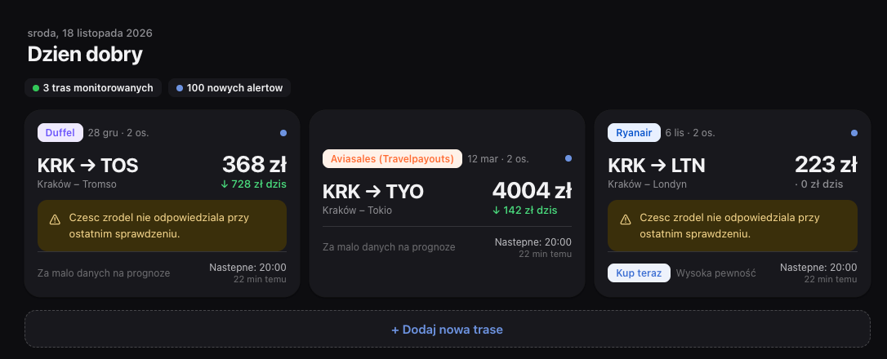

# automatyzacje

Rzeczy, które robię, żeby nie klikać tego samego codziennie. Większość to przepływy w n8n i skrypty w Pythonie odpalane z crona, do tego boty na Telegramie i chatbot z RAG, który odpowiada na podstawie własnej bazy dokumentów.

Tych przepływów nie wrzucam, bo są pełne kluczy API i prywatnych danych. Wrzucam za to kawałek największej rzeczy, czyli śledzenia cen lotów.

## śledzenie cen lotów

Dodajesz trasę (skąd, dokąd, kiedy, ewentualnie maksymalna cena), a apka co godzinę sprawdza ceny u kilku dostawców i zapisuje historię. Na tej podstawie:

- daje alert, jak cena spadnie, jak dojdzie do twojego limitu, jak jest nietypowo nisko albo jak prognoza pokazuje wzrost
- liczy prostą prognozę z widełkami i podpowiada: kupuj teraz, czekaj albo obserwuj

Prognoza celowo nie jest żadnym modelem ML. To mediana, trend liniowy, zmienność, liczba dni do wylotu i sezon. Przy kilkunastu punktach danych na trasę model i tak by się niczego nie nauczył, a tak każdą liczbę da się wytłumaczyć.

## co jest w repo

- `loty/prognoza.js` - prognoza ceny i rekomendacja
- `loty/alerty.js` - które alerty odpalić po sprawdzeniu ceny

## technologie

n8n, Python, JavaScript, PostgreSQL, Telegram Bot API, RAG, cron.

Więcej o mnie: [alex-rakowski.hatchable.site](https://alex-rakowski.hatchable.site)
