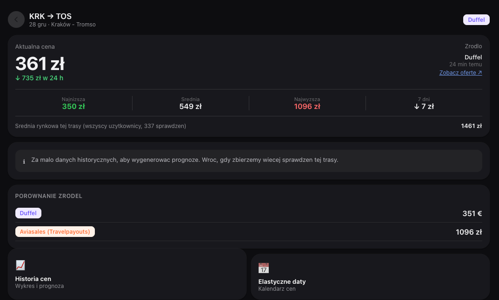

# automatyzacje

Rzeczy, które robię, żeby nie klikać tego samego codziennie. Większość to przepływy w n8n i skrypty w Pythonie odpalane z crona, do tego boty na Telegramie i chatbot z RAG, który odpowiada na podstawie własnej bazy dokumentów.

Tych przepływów nie wrzucam, bo są pełne kluczy API i prywatnych danych. Wrzucam za to kawałek największej rzeczy, czyli śledzenia cen lotów.

## śledzenie cen lotów

Dodajesz trasę, a apka co godzinę sprawdza ceny u kilku dostawców i zapisuje historię. Co w niej jest:

- trasy - dodajesz skąd, dokąd, daty, liczbę osób i maksymalną cenę, lotniska wybierasz z wyszukiwarki
- automatyczne sprawdzanie - co godzinę u kilku dostawców i tanich linii
- pulpit - wszystkie trasy z aktualną ceną i zmianą od ostatniego sprawdzenia
- szczegóły trasy - aktualna cena, najniższa, średnia i najwyższa, zmiana z 7 dni i link do oferty
- średnia rynkowa - ile średnio kosztuje ta trasa, licząc sprawdzenia wszystkich użytkowników
- porównanie źródeł - ta sama trasa u różnych dostawców obok siebie
- historia cen - wykres zmian ceny w czasie
- prognoza - widełki ceny, pewność i podpowiedź: kupuj, czekaj albo obserwuj
- elastyczne daty - kalendarz cen dla sąsiednich dni
- alerty - spadek ceny, cena docelowa, nietypowo tanio i przewidywany wzrost, z licznikiem nieprzeczytanych
- przeliczanie walut
- ustawienia i usuwanie wszystkich swoich danych jednym kliknięciem

Prognoza celowo nie jest żadnym modelem ML. To mediana, trend liniowy, zmienność, liczba dni do wylotu i sezon. Przy kilkunastu punktach danych na trasę model i tak by się niczego nie nauczył, a tak każdą liczbę da się wytłumaczyć.

## inne automatyzacje

- przepływy w n8n łączące różne usługi i API
- boty na Telegramie do powiadomień
- chatbot z RAG, który odpowiada na pytania na podstawie własnej bazy dokumentów
- skrypty w Pythonie odpalane z crona

## co jest w repo

- `loty/prognoza.js` - prognoza ceny i rekomendacja
- `loty/alerty.js` - które alerty odpalić po sprawdzeniu ceny

## technologie

n8n, Python, JavaScript, PostgreSQL, Telegram Bot API, RAG, cron.

Więcej o mnie: [alex-rakowski.hatchable.site](https://alex-rakowski.hatchable.site)
